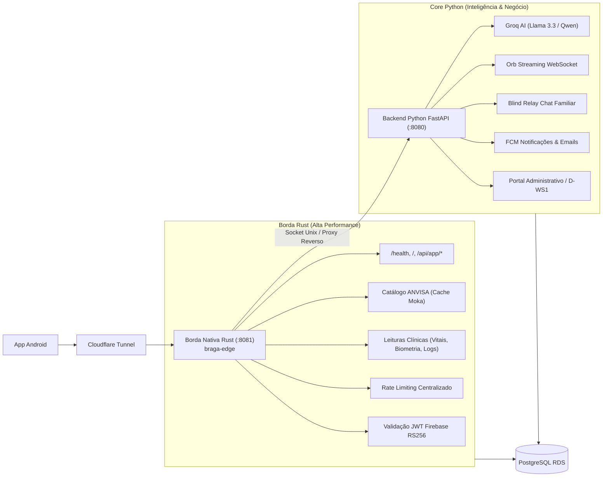

# Braga Saúde — Gateway API

> **API Backend de Alta Concorrência para o Ecossistema Braga Saúde (Aplicativo Android)**  
> **Arquitetura Híbrida em Produção:** Borda Nativa em Rust (`braga-edge` / Axum) + Core de Aplicação em Python (`FastAPI` / Gunicorn).  
> **Infraestrutura:** AWS EC2 (`t3.small`) + Amazon RDS PostgreSQL (`gp3`) + Cloudflare Tunnel + Groq Cloud (LLMs Clínicos).

---

## 🏗️ Arquitetura do Sistema

O Gateway opera em uma **pilha híbrida balanceada**, projetada para aliar a extrema performance e segurança de memória do Rust com a flexibilidade do ecossistema Python para processamento de IA e regras clínicas:



### 1. Borda Nativa em Rust (`rust/crates/braga-edge`)
- **Proxy Reverso & Borda HTTP/WebSocket:** Atendimento instantâneo com injeção automática de Security Headers (`nosniff`, `DENY`, CSP restritiva).
- **Catálogo de Medicamentos ANVISA (`GET /api/anvisa/medications/barcode/{ean}`):** Validação estrita de 13 dígitos e cache em memória de altíssima velocidade via [`moka`](https://crates.io/crates/moka) (TTL 5 min, LRU 10.000 itens).
- **Leituras Clínicas Autoritativas:** Consultas de alto volume (`vitals`, `biometry`, `daily-metrics`, `medications`, `activity-feed`) executadas nativamente no banco sem passar pelo runtime Python.
- **Identidade & Rate Limiter Único:** Validação criptográfica de tokens Firebase RS256 com cache de certificados do Google e proteção anti-abuso unificada entre workers.

### 2. Core de Aplicação em Python (`scripts/server/`)
- **Assistente Clínico & IA:** Integração com Groq Cloud para modelos conversacionais e transcrição de áudio.
- **Sincronização Complexa:** Processamento de regras de negócio, cálculo de dosagens e ingestão transacional.
- **Privacidade E2EE:** Roteamento cego (*Blind Relay*) de mensagens familiares cifradas de ponta a ponta.
- **Notificações & Background Jobs:** Despacho de push FCM, boletins de cuidado e emails transacionais.

---

## 🚀 Quick Start Local

### Pré-requisitos
- **Python 3.12+**
- **Rust estável 1.82+** (`cargo`, `rustfmt`, `clippy`)
- **PostgreSQL 16+** (opcional localmente se usar o simulador sintético)

### 1. Configuração do Backend Python
```bash
# Clone e entre no repositório
cd gateway-api

# Crie e ative o ambiente virtual
python3 -m venv venv
source venv/bin/activate

# Instale dependências pinadas
pip install -r requirements.txt

# Configure variáveis de ambiente
cp .env.example .env
```

Para rodar o backend Python:
```bash
cd scripts/server
source ../../venv/bin/activate
uvicorn server:app --host 0.0.0.0 --port 8080 --reload
```

> **Documentação Interativa (`/docs`, `/redoc`):**  
> Desativada em produção por segurança. Localmente, ative com:
> ```bash
> DEVELOPMENT_MODE=1 uvicorn server:app --host 0.0.0.0 --port 8080
> ```

---

### 2. Configuração da Borda Rust
```bash
cd rust

# Compilar em modo release
cargo build --release --bin braga-edge --bin braga-sim

# Executar a borda conectada ao backend
./target/release/braga-edge \
    --host 127.0.0.1 \
    --port 8081 \
    --backend-sock /run/braga-saude/backend.sock
```

---

## 📁 Estrutura do Repositório

```
gateway-api/
├── rust/                                # Workspace Rust da Borda e Ferramentas
│   ├── Cargo.toml                       # Definição do Workspace (6 crates)
│   ├── rust-toolchain.toml              # Toolchain estável fixado
│   └── crates/
│       ├── braga-contracts/             # DTOs e contratos serializáveis compartilhados
│       ├── braga-crypto/                # Criptografia ALE (AES-256-GCM), Argon2id, Blind Index
│       ├── braga-identity/              # Validação de JWT Firebase e autorização autoritativa
│       ├── braga-limiter/               # Rate limiter centralizado com janelas deslizantes
│       ├── braga-edge/                  # Binário de produção: proxy reverso, catálogo e leituras
│       └── braga-sim/                   # Harness de testes e simulação local de borda
│
├── scripts/
│   ├── server/                          # Monolito modularizado Python (FastAPI)
│   │   ├── server.py                    # Bootstrap e orquestração da aplicação
│   │   ├── routers/                     # Endpoints REST e WebSocket por domínio
│   │   │   ├── auth.py                  # Autenticação, OTP e sessões
│   │   │   ├── care_os.py               # Contratos de família, cuidadores e farmácia
│   │   │   ├── sync.py                  # Sincronização de saúde, perfil e vitais
│   │   │   └── admin.py                 # Portal administrativo / KPIs de serviço
│   │   ├── schemas/                     # Contratos Pydantic
│   │   ├── services/                    # Regras de negócio e workers em background
│   │   └── core/                        # Utilidades criptográficas e de rede
│   └── rust_migration/                  # Scripts de verificação e simulação de migração
│       └── simulate_local.py            # Harness local leve para gates de liberação (G0–G4)
│
├── migrations/                          # Migrations versionadas PostgreSQL (001 a 079+)
└── .github/workflows/                   # Pipelines de CI/CD (Testes, Rust CI e Deploy EC2)
```

---

## 🔌 Rotas Principais da API

| Método | Caminho | Executor | Descrição |
|---|---|---|---|
| **GET** | `/health` | Rust (`braga-edge`) | Liveness check instantâneo (`200 OK`) |
| **GET** | `/` | Rust (`braga-edge`) | Landing informativa do canal Google Play |
| **GET** | `/api/app/latest` | Rust (`braga-edge`) | Canal próprio encerrado (`410 Gone` direcionando para a Play Store) |
| **GET** | `/api/anvisa/medications/barcode/{ean}` | Rust (`braga-edge`) | Catálogo oficial com cache Moka em memória |
| **GET** | `/api/vitals/{user_id}` | Rust (`braga-edge`) | Histórico de sinais vitais (titular ou cuidador autorizado) |
| **GET** | `/api/biometry/{user_id}` | Rust (`braga-edge`) | Histórico biométrico de peso, altura e IMC |
| **GET** | `/api/metrics/daily/{user_id}` | Rust (`braga-edge`) | Métricas diárias de passos, distância e calorias |
| **GET** | `/api/medications/{user_id}` | Rust (`braga-edge`) | Lista de medicamentos em uso do paciente |
| **GET** | `/api/medications/{user_id}/logs` | Rust (`braga-edge`) | Histórico de tomadas de doses |
| **GET** | `/api/family/patients/{id}/activity-feed` | Rust (`braga-edge`) | Trilha compartilhada de auditoria da família |
| **POST** | `/api/auth/otp/send` e `/verify` | Python (`FastAPI`) | Autenticação móvel via OTP e emissão de sessão |
| **POST** | `/api/sync/vitals` | Python (`FastAPI`) | Ingestão e disparo de alertas clínicos para cuidadores |
| **POST** | `/v1/chat/completions` | Python (`FastAPI`) | Canal conversacional de inteligência artificial clínica |
| **WS** | `/ws/orb` | Python (`FastAPI`) | Sessão contínua de diálogo por voz streaming (Orb) |
| **POST** | `/api/family/messages/e2ee` | Python (`FastAPI`) | Blind Relay de chat familiar criptografado de ponta a ponta |

---

## 🛡️ Segurança & Conformidade de Dados

- **Segredos Dinâmicos (Zero `.env` em Produção):** Chaves e credenciais sensíveis são resolvidas em runtime via **AWS Systems Manager Parameter Store + AWS KMS**, carregadas diretamente na memória (`tmpfs`).
- **Application-Level Encryption (ALE):** Dados clínicos sensíveis armazenados no banco contam com envelope de criptografia **AES-256-GCM** com DEKs derivadas via HKDF-SHA256.
- **Blind Indexing Determinístico:** Consultas exatas sobre campos confidenciais utilizam HMAC-SHA256 com salt/pepper dedicado, sem necessidade de descriptografar linhas completas.
- **Criptografia Ponta a Ponta (E2EE):** O chat familiar utiliza ECDH (secp256r1) no cliente Android; o servidor atua estritamente como *Blind Relay*, armazenando apenas o envelope cifrado sem acesso ao conteúdo textual.
- **Mitigação de Abusos:** Rate limiter centralizado com bloqueio de IP de 24h após múltiplas violações, protegendo endpoints de autenticação e OTP.

---

## 🧪 Testes & Validação de Qualidade

### 1. Simulação Local Leve (Obrigatória antes de deploys)
Harness leve sem dependências externas pesadas ou banco local:
```bash
# Executa todos os testes sintéticos das Fases 0, 1 e 2
python3 scripts/rust_migration/simulate_local.py --phase 2
```

### 2. Suíte de Testes Rust
```bash
cd rust
cargo fmt --all -- --check                      # Checagem de formatação
cargo clippy --workspace --all-targets -- -D warnings # Lint estático estrito
cargo test --workspace --verbose                # Testes unitários do workspace
```

### 3. Suíte de Testes Python
```bash
cd scripts/server
source ../../venv/bin/activate
pytest -q
```

---

## 🚢 CI/CD & Deploy em Produção

- **Integração Contínua (GitHub Actions):** Workflows dedicados executam validações de formatação, linters, migrações idempotentes e compilação multiplataforma a cada push.
- **Deploy EC2 Automatizado via AWS SSM:**
  - Deploys na branch `master` disparam a esteira de atualização via AWS Systems Manager Run Command sem expor portas SSH na internet.
  - O serviço `braga-edge` é gerenciado como daemon contínuo via `systemd` (`braga-edge.service`) com isolamento de privilégios (`NoNewPrivileges=true`, `LimitCORE=0`).
  - Releases de binários x86_64 pré-compilados são publicadas automaticamente nas [Releases do GitHub](https://github.com/Fernandes-Yuri/gateway-api/releases).
