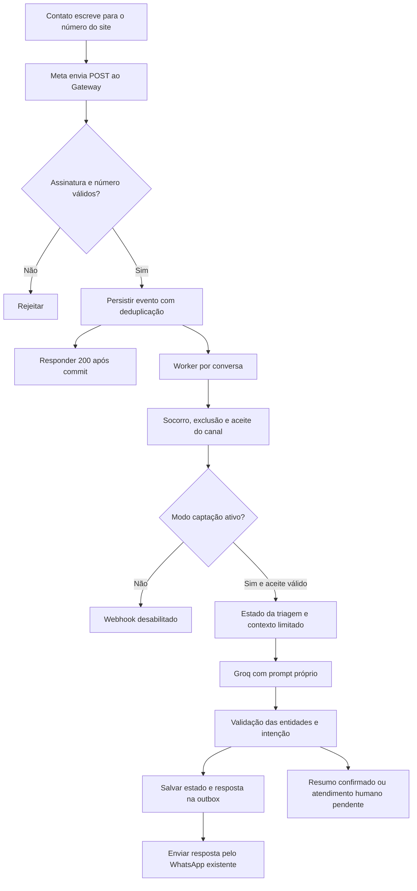

# Captação de pacientes pelo WhatsApp no Gateway API

Desenho e prompt v1, 21/10/2026. A implementação inicial já está conectada ao webhook sob `WHATSAPP_INTAKE_ENABLED`, desativada por padrão, com ativação operacional separada. O prompt de produção permanece ativo até a ativação do novo modo. O [contrato operacional](whatsapp-gateway-operations-v1.md) descreve as rotas e os limites efetivamente implementados; prevalece sobre os nomes propostos abaixo.

## Decisões de produto

O número divulgado no site recebe o primeiro contato no Gateway API. Reutilizar a configuração existente de WhatsApp e a chave Groq destinada ao WhatsApp. O prompt de captação é próprio e não herda ações de prontuário, medicamentos ou vínculo do assistente do aplicativo.

A persona é Yuri, assistente virtual do atendimento, com linguagem direta, tranquila e acolhedora. O assistente se apresenta como virtual e não afirma ser o Yuri humano. Coleta uma informação por vez quando necessário, aproveita respostas espontâneas e permite recusa. Nome/gênero do contato e nome/idade/gênero do paciente são entidades distintas. Para atendimento próprio, nome e gênero do paciente derivam do contato somente depois de `care_for=self` explícito.

Não é possível determinar com segurança se o contato veio do site somente pelo remetente ou por uma mensagem predefinida do link. Nesta primeira versão, a configuração proposta `WHATSAPP_INTAKE_ENABLED=true` torna o número configurado um canal de captação para todos os contatos de entrada. Desativada, retorna 404 no webhook; o canal de saúde retirado não é reativado. Se for necessário manter simultaneamente a experiência do app no mesmo número, implementar uma seleção explícita de finalidade com estado persistido antes de ativar esse modo; não inferir a escolha pela LLM.

## Base da implementação

A base atual da `master` retirou o antigo canal de saúde pela migration 066. A captação Yuri usa módulos próprios (`routers/whatsapp_intake.py`, `services/wa_intake_*`) e tabelas da migration 068. Não recria vínculo TOTP entre WhatsApp e paciente, não consulta prontuário do aplicativo e não usa Firebase Auth para autorizar a central. O cadastro do futuro APK exige o mesmo TOTP mestre do portal; ver [contrato operacional](whatsapp-gateway-operations-v1.md).

As configurações Meta/Groq existentes são reutilizadas apenas no processo servidor. O App Secret da Meta valida assinatura de webhook e não pode ser substituído pelo token de envio ou pelo verify token. O TOTP administrativo é outra finalidade e nunca atravessa o contrato de mídia ou atendimento.

Não copiar segredos para documentação, código, fixtures ou logs. O caminho do arquivo local não deve virar caminho fixo da aplicação. As variáveis entram no processo pelo mecanismo de ambiente já usado no deploy.

## Fluxo proposto



1. Preservar GET de verificação e POST com HMAC obrigatório. Conferir `metadata.phone_number_id` contra o número configurado antes de processar mensagens. Eventos de status atualizam entrega, sem chamar a LLM.
2. Persistir mensagens autenticadas em inbox transacional antes do 200. Se falhar a persistência, responder 503 para permitir reentrega. Deduplicar pelo identificador da Meta e número receptor. Limitar tamanho do corpo e validar a estrutura do lote.
3. Worker seleciona itens com lease, tentativas e próxima execução. Processar um item por vez por conversa, usando serialização no PostgreSQL; o lock atual pode ser reaproveitado. Worker deve rodar e recuperar leases vencidos após reinício, sem depender de `BackgroundTasks`.
4. Aplicar os controles de socorro, exclusão e aceite antes de transcrição ou Groq. A fila pré-aceite guarda apenas o evento necessário, com retenção curta; nunca enviar esse conteúdo ao modelo ou ao treinamento. Não reproduzir mensagens pessoais anteriores ao aceite.
5. O aceite de captação convida a continuar o atendimento, sem exigir vínculo com app. Usar aceite em texto, sem menu numérico. Preservar validade, versionamento e proteção contra reentregas anteriores ao aceite.
6. Carregar estado estruturado da triagem e um histórico recente limitado, isolados por número receptor, remetente e triagem. Áudios passam pela transcrição existente só após aceite. Conferir urgência também no texto transcrito. Tipos não suportados recebem orientação curta, sem inventar conteúdo.
7. Chamar Groq com o prompt v1, JSON Object Mode quando compatível com o modelo configurado, timeout e limite de saída. JSON válido não garante contrato válido: validar tipos, enumerações, tamanhos, evidências e caminhos de campos no servidor.
8. Salvar atomicamente as alterações validadas e a resposta pendente de envio. O modelo não altera identidade, autorizações, tabelas clínicas, destinatários ou credenciais.
9. Enviar pela função existente e registrar identificador de saída/resultado. Tratar falhas transitórias com backoff e limite de tentativas. Uma resposta externa aceita imediatamente antes de uma queda pode ser reenviada: não prometer entrega exatamente uma vez. Estados ambíguos precisam de reconciliação e visibilidade operacional.
10. Resumo e correções continuam na mesma triagem. Após confirmação do resumo, criar um item durável para a equipe. O estado é `handoff_pending` até que um consumidor humano/CRM efetivamente aceite. Só então informar encaminhamento confirmado.

## Dados e contrato de extração

Cada campo mantém `value`, `status`, evidência e referência à mensagem de origem. Ausência é `missing`; pessoa que não sabe gera `unknown`; recusa gera `declined`. Não converter silêncio em recusa ou inferir um valor.

| Campo | Regra |
| --- | --- |
| `contact.full_name` | Nome completo informado; um primeiro nome não prova nome completo |
| `contact.gender` | Autodeclarado; recusa aceita |
| `care_for` | `self` ou `other`, confirmado pela pessoa |
| `relationship` | Relação informada quando houver terceiro |
| `patient.full_name` | Distinto do contato se `other` |
| `patient.age_years` | Idade informada, inclusive fração para bebês; necessária na busca para terceiro, respeitada a recusa |
| `patient.gender` | Autodeclarado ou relatado explicitamente; não inferir |
| `payment.kind` | `private` ou `insurance` |
| `payment.insurer`, `payment.plan` | Perguntar se houver convênio; não implica cobertura aceita |
| `clinical.chief_complaint` | Queixa ou objetivo da consulta |
| `clinical.onset`, `clinical.impact` | Início e impacto, quando aplicáveis; não transformar check-up sem queixa em interrogatório de sintomas |
| `clinical.additional_notes` | Contexto relevante espontâneo; sem investigação clínica extensa |

Exemplo sintético de saída da LLM:

```json
{
  "reply": "Entendi, é para sua mãe. O que está levando ela a procurar atendimento agora?",
  "updates": {
    "care_for": {"value": "other", "status": "provided", "evidence": "minha mãe"},
    "relationship": {"value": "mãe", "status": "provided", "evidence": "minha mãe"},
    "patient.age_years": {"value": 68, "status": "provided", "evidence": "68 anos"}
  },
  "intent": "continue"
}
```

O servidor define campos pendentes e conclusão; não aceita `complete=true` do modelo. Evidência precisa constar da mensagem atual e sustentar a extração, além da validação sintática. Em contradição não explícita, perguntar antes de substituir. Em troca de paciente, abrir outra triagem após confirmação; não reutilizar dados clínicos anteriores. Histórico enviado ao modelo sempre mantém papéis originais, nunca promovendo conteúdo recebido a instrução de sistema.

Estados da triagem: `collecting` → `awaiting_summary_confirmation` → `handoff_pending` → `handed_off`. O modo da conversa (`bot`, `waiting_human`, `human`, `closed`) é separado do estado da triagem; regras detalhadas estão no contrato da central interna. Também existem `human_requested`, `emergency`, `cancelled` e `expired`. Pedido humano e urgência interrompem a coleta sem exigir preenchimento. A confirmação deve se referir ao resumo persistido e mostrado; correção invalida a confirmação anterior.

## Persistência e operação

A migration 068 implementa persistência própria, sem reutilizar prontuário nem criar vínculo de paciente pelo telefone. O desenho abaixo corresponde aos domínios; nomes e colunas efetivos estão no SQL e no contrato operacional:

- `whatsapp_intake_conversations`: número receptor, chave pseudonimizada do remetente, triagem ativa, estado validado, versão do prompt, revisão do resumo e datas.
- `whatsapp_intake_inbox`: identificador único de mensagem, conversa, payload mínimo, lease, tentativas, expiração e situação.
- `whatsapp_intake_messages` e `whatsapp_intake_media`: mensagens recebidas/enviadas, transcrições e anexos privados. A outbox é o estado de entrega das mensagens, sem tabela separada. O destinatário vem da conversa autenticada.
- `whatsapp_intake_handoffs`: resumo confirmado e situação da entrega à equipe; chave única por triagem/revisão.

Manter telefone necessário ao envio em armazenamento restrito, com proteção em repouso e acesso mínimo. Hash de telefone é pseudonimização, não anonimização. Logs operacionais contêm contagens, latência, códigos e identificadores técnicos; não conteúdo pessoal, evidências, prompts completos ou segredos. Não usar esse fluxo como dataset de treinamento.

Configuração de retenção obrigatória antes de ativar: prazos distintos para fila pré-aceite, histórico de conversa, triagens abandonadas e resumos encaminhados, acordados com o responsável pelo atendimento. Jobs de expurgo devem remover conteúdo e mídia transitória; a exclusão do canal deve abranger as quatro tabelas e filas relacionadas, impedindo reenvio ou recriação por worker em andamento. Backups têm política própria documentada.

Métricas: tamanho/idade da fila, falhas de assinatura, duplicatas, latência da Groq, contrato inválido, tentativas de envio, itens esgotados, pedidos humanos e encaminhamentos pendentes. Não usar telefone, nome ou queixa como labels.

## Prompt e comportamento de falha

Prompt versionado em `docs/prompts/whatsapp-clinic-intake-v1.txt`. Está ligado ao serviço de captação com schema validado no servidor; a cópia de runtime fica em `scripts/server/prompts/whatsapp_intake_v1.txt`, e o teste confere a igualdade entre as versões.

Na indisponibilidade do modelo, não inventar triagem: preservar estado, informar falha breve e permitir nova tentativa ou pedido humano. JSON inválido não é enviado ao paciente nem aplicado ao estado. Falha na persistência impede confirmação de registro. Falta de segredo de assinatura impede ativação do recebimento. Falha do serviço de encaminhamento mantém `handoff_pending`, sem alegar transferência concluída.

## Critérios de aceite para a implementação

- Desafio GET correto/errado; assinatura ausente, inválida e válida; número receptor divergente; payload inválido; eventos só de status.
- Inbox antes do 200; duplicata no mesmo lote e em reentrega; queda após commit; lease vencido; falhas transitórias e permanentes do envio.
- Coleta para si e familiar, múltiplas entidades na mesma frase, correção, gênero recusado, idade desconhecida, particular e convênio, queixa preventiva e mudança de paciente.
- Uma pergunta principal, sem repetir dados conhecidos; identidade virtual transparente; nenhuma promessa de cobertura, agenda ou encaminhamento inexistente.
- Sem aceite, sem transcrição/Groq; socorro preservado; exclusão interrompe worker e limpa estado/filas; isolamento entre remetentes e triagens.
- Pedido humano sem campos completos; resumo mostrado e confirmado; correção invalida resumo; confirmação solta não conclui; reentrega não duplica encaminhamento.
- Contexto hostil não muda prompt, destinatário, autorização ou campos permitidos; saída inválida não grava entidades.
- Validação de credenciais/modelo e teste de ponta a ponta em ambiente controlado antes de ativar o número real. Não enviar mensagem de teste para pacientes.

## Referências

- [Groq: Structured Outputs](https://console.groq.com/docs/structured-outputs): distinção entre JSON Object Mode e conformidade de schema; suporte depende do modelo.
- [Meta: verificação de webhooks](https://whatsapp.github.io/WhatsApp-Nodejs-SDK/api-reference/webhooks/start/): desafio GET e assinatura de POST usam segredos com finalidades diferentes. Referência conceitual do SDK arquivado; a implementação segue a validação HMAC existente no Gateway.

## Central interna de atendimento

O acompanhamento e a intervenção humana são parte do escopo: [contrato da central Android e controle humano](whatsapp-internal-console-v1.md). O aviso ao Yuri será uma notificação no APK, com resumo acessível após autenticação. Após confirmação do resumo, a conversa entra em `waiting_human`; a LLM deixa de responder automaticamente até retomada explícita. Áudios recebidos continuam sendo transcritos nesse modo e em `human`.
